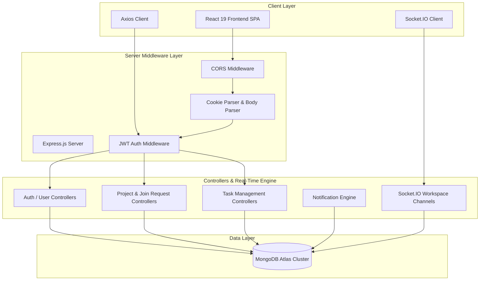
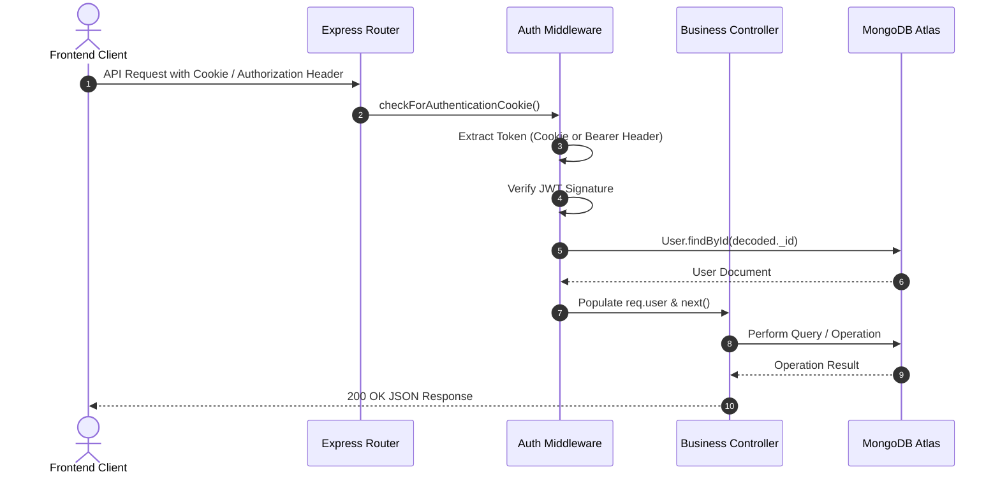

# 🚀 DevCollab Backend API — Node.js & Express REST Service

> **Backend API Repository** | *Looking for the frontend client application? Visit [DevCollab Frontend Repository](https://github.com/vrushabhdarekar22/DevCollab-frontend)*

DevCollab Backend is a high-performance REST API and Socket.IO real-time server built with Node.js, Express.js, and MongoDB. It powers user authentication, project recruitment, Kanban task workflows, real-time workspace messaging, notification dispatching, and live shared notes synchronization for the **DevCollab** platform.

---

## 🔗 Project Repositories & Live Links

| Component | Repository Link | Deployed Endpoint |
| :--- | :--- | :--- |
| **Backend API** | [👉 DevCollab Backend](https://github.com/vrushabhdarekar22/DevCollab-backend) | [⚙️ REST API & WebSockets](https://devcollab-backend-1.onrender.com) |
| **Frontend App** | [👉 DevCollab Frontend](https://github.com/vrushabhdarekar22/DevCollab-frontend) | [🌐 Live Application](https://dev-collab-frontend-79h6.vercel.app/) |

---

## 🏗️ System Architecture

The DevCollab server is architected using a modular Controller-Service-Model design pattern with independent Socket.IO WebSocket handlers and JWT authentication middlewares.



---

## 💻 Backend Tech Stack

| Technology | Purpose |
| :--- | :--- |
| **Node.js** | Asynchronous JavaScript runtime environment |
| **Express.js v5** | Web application framework for RESTful API routing |
| **MongoDB Atlas** | Cloud-native NoSQL database |
| **Mongoose v8** | Object Data Modeling (ODM) for schema management |
| **Socket.IO v4** | Event-driven WebSocket server for real-time channels |
| **JSON Web Tokens (JWT)** | Stateless security token generation and verification |
| **Nodemailer** | Transactional SMTP email delivery for OTP verification |
| **Cookie-Parser** | HTTP cookie extraction middleware |
| **CORS** | Cross-Origin Resource Sharing security configuration |

---

## 🔐 Authentication & Security Model

* **Dual Token Verification**:
  1. **HTTP-Only Cookies**: Checks `req.cookies["token"]` with `SameSite=None` and `Secure=true` in production environments.
  2. **Bearer Token Fallback**: Checks `req.headers.authorization` (`Bearer <token>`) for cross-domain API compliance.
* **Database Models & Roles**: User authentication schema includes secure password hashing, developer tech skills array, and user metadata.



---

## 📦 Directory Structure

```text
DevCollab-Backend/
├── controllers/                   # Route business logic handlers
│   ├── auth/                      # Authentication controllers
│   ├── notification/              # Notification retrieval & read status
│   ├── project/                   # Project CRUD, recruitment, join requests, notes
│   ├── task/                      # Kanban task CRUD & assignment
│   └── user/                      # Profile retrieval & update handlers
├── middlewares/
│   ├── authentication.js          # Dual-mode (Cookie + Bearer) JWT authentication
│   └── authorization.js           # Project owner permission checks
├── models/
│   ├── message.js                 # Chat messages schema
│   ├── note.js                    # Shared workspace notes schema
│   ├── notification.js            # User notification schema
│   ├── project.js                 # Project, members & join requests schema
│   ├── task.js                    # Kanban tasks schema
│   └── user.js                    # User account schema with password hashing
├── routes/
│   ├── auth.js                    # /auth API endpoints
│   ├── notification.js            # /notification API endpoints
│   ├── project.js                 # /project API endpoints
│   ├── task.js                    # /task API endpoints
│   └── user.js                    # /user API endpoints
├── services/
│   ├── authentication.js          # JWT signing & verification utilities
│   └── notify.js                  # In-app push notification generator
├── .env.example                   # Environment configuration template
├── index.js                       # Express app, CORS, Mongoose connection & Socket.IO server
└── package.json
```

---

## ⚙️ Local Development Setup

```bash
# Clone the repository
git clone https://github.com/vrushabhdarekar22/DevCollab-backend.git
cd DevCollab-backend

# Install dependencies
npm install

# Copy environment variable template
cp .env.example .env
```

Configure your local `.env` file:
```env
PORT=8000
NODE_ENV=development
MONGO_URL=mongodb+srv://<username>:<password>@cluster.mongodb.net/devcollab?retryWrites=true&w=majority
JWT_SECRET=your_super_secret_jwt_key
CLIENT_URL=http://localhost:5173
CORS_ORIGINS=http://localhost:5173,http://127.0.0.1:5173
SMTP_HOST=smtp.gmail.com
SMTP_PORT=587
SMTP_USER=your_email@gmail.com
SMTP_PASS=your_gmail_app_password
MAIL_FROM="DevCollab <your_email@gmail.com>"
```

Run the backend development server:
```bash
npm run dev
# Server running at http://localhost:8000
```

---

## 💡 Key Technical Challenges Resolved

### 1. **Cross-Domain Cross-Site Cookie Delivery**
* **Challenge**: When frontend requests originated from Vercel (`.vercel.app`) to Render (`.onrender.com`), browsers blocked standard HTTP-only cookies.
* **Solution**: Configured dynamic cookie security (`sameSite: "none"`, `secure: true` in production) combined with an Authorization Bearer header fallback in Express authentication middleware.

### 2. **Socket.IO Circular Dependency Fix**
* **Challenge**: Controllers importing `io` from `index.js` caused Node.js circular module loading errors where `io` evaluated to `undefined` during execution.
* **Solution**: Implemented a dynamic `getIO()` getter inside controllers to retrieve the initialized Socket.IO instance lazily at request runtime.

---

## 👨‍💻 Authors & Contributors

| Developer | Information | Links |
| :--- | :--- | :--- |
| **Vrushabh Darekar** | B.E. Information Technology<br>Pune Institute of Computer Technology (PICT), Pune | [GitHub](https://github.com/vrushabhdarekar22) • [LinkedIn](https://linkedin.com/in/vrushabh-darekar) |
| **Harshad Kavade** | B.E. Computer Technology<br>Pune Institute of Computer Technology (PICT), Pune | [GitHub](https://github.com/HarshadKavade) • [LinkedIn](https://www.linkedin.com/in/harshad-kavade-7a1941294/) |
